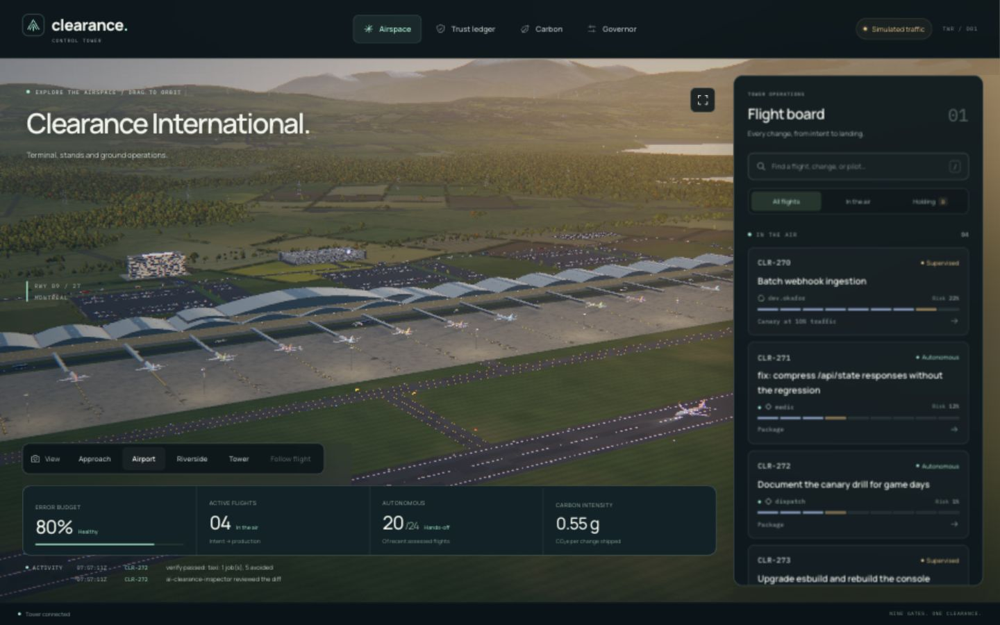
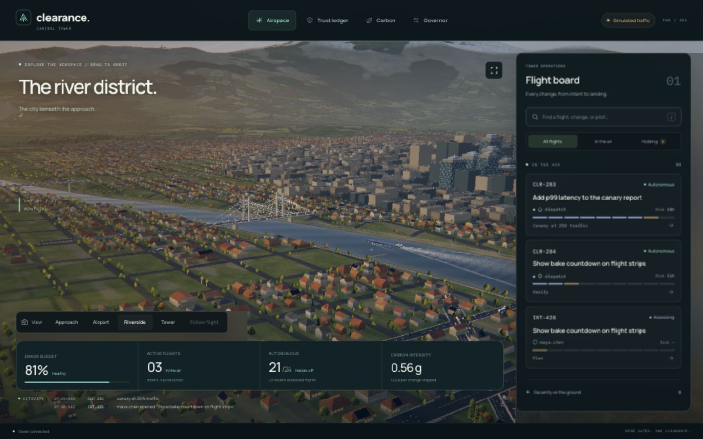
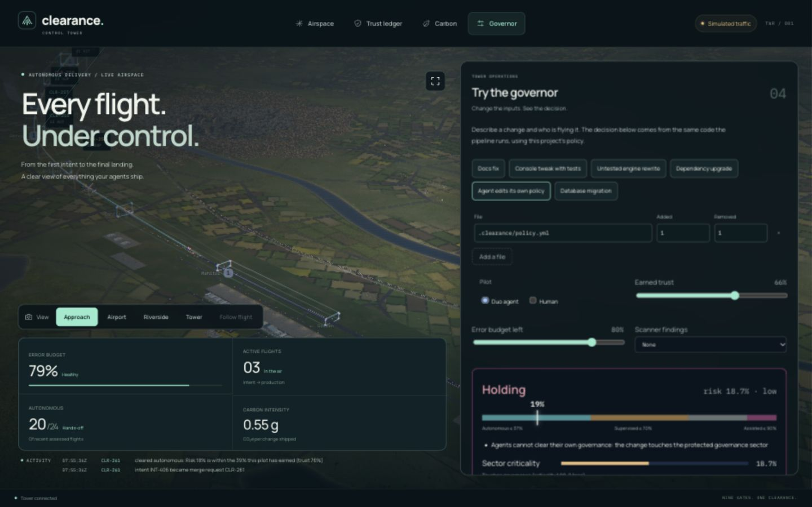
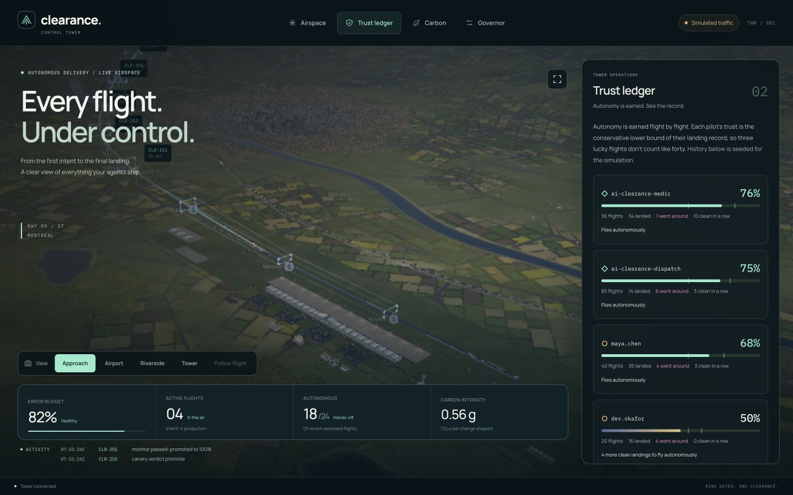
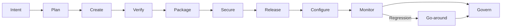

<div align="center">


# Clearance

**An immersive 3D workspace for understanding software delivery.**

Every change is a flight. See its progress, understand its risk and explore the decision behind its clearance.

[](https://github.com/Siddhanthkjain2005/CLEARANCE/actions/workflows/ci.yml)
[](LICENSE)
[](package.json)
[](tsconfig.json)

[Live demo](https://clearance-tower-30123867341.northamerica-northeast1.run.app/) · [Design case study](docs/design-case-study.md) · [Quick start](#quick-start) · [Documentation](docs/README.md)

</div>


> **Demo status:** the public app is deployed on Google Cloud Run with clearly labelled simulated traffic. The risk and governor logic is implemented; real GitLab Duo sessions and delivery pipelines are not connected to this preview. [Deployment evidence](docs/proof/cloud-deployment.json) · [Verification notes](docs/proof/README.md)

## Why Clearance?

Delivery information is scattered across issues, pipeline logs, approvals and monitoring screens. Developers and reviewers need to answer three questions quickly: what is moving, what needs attention, and why?

Clearance brings those questions into one spatial interface. Every change becomes a flight, with nine delivery stages forming its approach. A successful release lands; a blocked change holds; a failed canary goes around. A searchable flight board and readable inspectors keep the underlying information close at hand.

## Designed around the next decision

- **Learn, then explore.** The landing page introduces the flight metaphor through a scroll-driven journey before opening the operational console.
- **Overview, then detail.** The airspace shows the overall situation; selecting a flight reveals its stage history, risk signals and clearance explanation.
- **Understand by trying.** The Governor playground lets visitors vary a proposed change and see the decision update without changing production policy.
- **Keep information usable.** Semantic HTML controls, visible focus states, text status labels, reduced-motion support and responsive panels complement the 3D scene.
- **Make the world coherent.** A procedural airport, river, city, terrain and traffic give the camera journey a consistent setting.

Read the [design case study](docs/design-case-study.md) for user journeys, information architecture, interaction choices, accessibility details and current validation limits.

## What is inside

| Capability | What it provides |
|---|---|
| **Interactive 3D console** | Procedural airport, aircraft, city, water, ground traffic and landscape; searchable flight board and detailed inspectors. |
| **Guided product story** | A scroll-driven landing page, nine lifecycle chapters and direct routes into the analytical views. |
| **Decision playground** | Editable change inputs, six presets and immediate policy explanations. |
| **Deterministic governor** | Explainable autonomous, supervised, assisted and hold decisions from the same TypeScript engine used by the console and CLI. |
| **Earned trust** | A conservative, risk-weighted pilot record with time decay, clean-landing streaks and an autonomy threshold. |
| **Risk-adaptive verification** | Generated GitLab child pipelines, test-impact analysis and verification tiers matched to the change. |
| **Canary analysis** | Error-rate and latency comparisons, SLO burn checks, promotion, extended observation and rollback decisions. |
| **Evidence and footprint** | Hash-chained records, optional HMAC authentication and a documented Software Carbon Intensity model. |
| **GitLab integration** | Dispatch, Medic and Debrief flow definitions, an agent configuration, CI/CD templates and eight read-only MCP tools. |

The automation definitions are included for configuration and validation in a GitLab project. GitHub hosts this source repository and its verification workflow.

## Explore the demo

| View | What to try |
|---|---|
| [Home](https://clearance-tower-30123867341.northamerica-northeast1.run.app/) | Follow the scroll-driven story through all nine delivery gates. |
| [Airspace](https://clearance-tower-30123867341.northamerica-northeast1.run.app/tower) | Search a flight, open its inspector and switch between Approach, Airport, Riverside and Tower cameras. |
| [Trust ledger](https://clearance-tower-30123867341.northamerica-northeast1.run.app/ledger) | Inspect pilot histories, confidence estimates and the autonomy threshold. |
| [Carbon](https://clearance-tower-30123867341.northamerica-northeast1.run.app/carbon) | Explore modelled emissions, avoided verification work and regional coefficients. |
| [Governor](https://clearance-tower-30123867341.northamerica-northeast1.run.app/governor) | Change the file list, trust, error budget and scanner findings to inspect a policy decision. |

<table>
  <tr>
    <td width="50%"><br /><sub>Airport and ground operations</sub></td>
    <td width="50%"><br /><sub>City, river and surrounding landscape</sub></td>
  </tr>
  <tr>
    <td width="50%"><br /><sub>Explainable policy decisions</sub></td>
    <td width="50%"><br /><sub>Trust earned through recorded outcomes</sub></td>
  </tr>
</table>

## Quick start

Use **Node.js 22.18 or newer** and npm.

```sh
git clone https://github.com/Siddhanthkjain2005/CLEARANCE.git
cd CLEARANCE
npm ci
npm run dev
```

Open [localhost:8080](http://localhost:8080). Without GitLab credentials, the Tower starts with labelled simulated traffic. A production-style local run is:

```sh
npm run build
npm start
```

For explicit environment settings, copy [.env.example](.env.example) to `.env` and start the built server with `node --env-file=.env src/tower/server.ts`. The npm commands do not automatically load `.env`.

## The delivery model



| Clearance | Human involvement | Default canary traffic steps |
|---|---|---|
| Autonomous | No intermediate approval for an eligible, cleared change | 25% → 50% → 100% |
| Supervised | Approve the outcome | 10% → 25% → 50% → 100% |
| Assisted | Review the individual steps | 5% → 25% → 50% → 100% |
| Hold | Owner intervention required | No deployment |

Protected governance, detected secrets and critical findings can hold a change regardless of trust. The [product overview](docs/product-overview.md) explains the full workflow and its current evidence boundary.

## Technology

- **Interface:** TypeScript, React-compatible TSX rendered by Preact, CSS and a small History API router.
- **3D world:** custom WebGL2/GLSL renderer, procedural geometry, instancing, shadows, water reflections and adaptive effects.
- **Server:** Node.js HTTP, REST, server-sent events, MCP and Prometheus-format metrics; no runtime npm dependencies.
- **Delivery:** GitLab Duo flow definitions, risk-adaptive CI/CD, Docker and Terraform.
- **Hosting:** Cloud Build, Artifact Registry and Cloud Run in a separate Google Cloud project.

## Verify locally

```sh
npm run typecheck
npm test
npm run build
node src/cli/clearance.ts budget dist/web
node src/cli/clearance.ts doccheck
npm run test:smoke
```

`node scripts/check-readiness.ts` runs the complete local sequence and exports labelled mock-integration evidence. The browser bundle has a **160 KiB gzip budget**; the recorded production build is approximately **146 KiB**. See [verification evidence](docs/proof/README.md) for the scope of the checks and the distinction between local fixtures and live integrations.

## Repository map

```text
src/
  core/          Risk, policy, trust, canary, evidence and SCI modules
  cli/           Pipeline and local command-line tools
  tower/         HTTP server, SSE, MCP, simulator and GitLab synchronization
  web/           Console panels and procedural WebGL2 world
test/            Unit, integration, geometry, build and server checks
scripts/         Build, readiness and setup helpers
infra/terraform/ Google Cloud infrastructure templates
docs/            Product, architecture, setup, demos and verification
.github/         GitHub verification workflow and contribution templates
.gitlab/         GitLab CI includes, Duo definitions and project templates
.clearance/      Protected policy and sector configuration
```

Start with the [documentation index](docs/README.md), [contribution guide](CONTRIBUTING.md) or [complete website walkthrough](docs/demo/website-walkthrough.md).

## Status and scope

The hosted interface is available with labelled simulated traffic and locally tested decision logic. Connecting real GitLab Duo execution and pipeline history is an optional integration step. Simulated agent actions and evidence badges are examples, and SCI figures use the assumptions documented in the [carbon methodology](docs/sci-methodology.md). Formal usability studies and a complete accessibility audit have not been conducted.

## Contributing and security

Read [CONTRIBUTING.md](CONTRIBUTING.md) before changing the project. Report vulnerabilities through the private process in [SECURITY.md](SECURITY.md).

## License

[MIT](LICENSE). See [third-party notices](THIRD_PARTY_NOTICES.md) for bundled software and font attribution.
