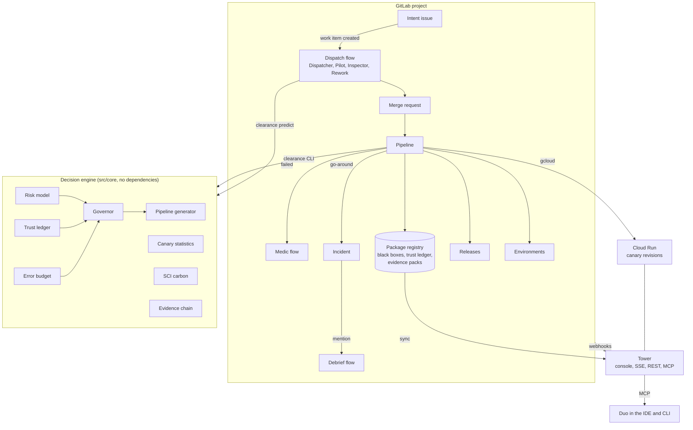

# Architecture

Clearance connects a procedural 3D console, a Node.js Tower and a deterministic decision engine. The console presents flight progress and explains decisions; the Tower supplies snapshots and events; the engine evaluates risk, trust and operating conditions.

The public demo uses simulated delivery traffic. In a connected GitLab deployment, project records supply issues, merge requests, pipelines and outcomes. GitLab Duo flow definitions support planning, implementation, review, repair and incident debriefing.

## Decision engine (`src/core`)

Pure TypeScript with no dependencies and no I/O. The same modules run in the pipeline, in the Tower, in the browser (the Governor playground) and in the simulator, so every surface shows the same decision for the same input.

| Module | Responsibility |
|---|---|
| `risk.ts` | Eight heuristic change-risk signals, combined by noisy-OR: `1 − Π(1 − pᵢ)`. Sector criticality comes from `.clearance/airspace.yml`. |
| `trust.ts` | Beta-Bernoulli track record per pilot with risk-weighted updates and a 30-day half-life. The governor uses the one-sided 90% lower bound. |
| `governor.ts` | Hard holds first (protected sectors for agents, critical findings, secrets, freeze windows, exhausted budget). Then the allowance `max_risk × budget_factor × (1 + ½·max(0, trust − min_trust))` and the level thresholds. Returns the reasons, the canary plan and the pipeline tier. |
| `pipeline.ts`, `impact.ts` | Generates the child pipeline for the tier. Test impact analysis walks the reverse import graph from the changed modules. |
| `canary.ts`, `stats.ts`, `slo.ts` | Two-proportion z-test, Mann–Whitney U with tie correction, multiwindow burn rates (SRE Workbook), all implemented from first principles. |
| `sci.ts` | Software Carbon Intensity per change shipped. |
| `evidence.ts` | Hash-chained records over canonical JSON, an HMAC signature on the chain head, and a mapping to SOC 2, ISO 27001 and NIST SSDF controls. |
| `projection.ts`, `events.ts` | The flight event vocabulary and the fold into console views. |
| `yaml.ts`, `glob.ts`, `gitlab.ts` | A strict YAML subset parser (it treats `echo "a: b"` as a mapping, as GitLab does), CODEOWNERS-style globs and a small REST client. |

## Pipeline (`.gitlab-ci.yml`, `.gitlab/ci/`)

- `clearance:assess` computes risk and preliminary clearance and writes the child pipeline as an artifact. `verify:flight` triggers it with `strategy: depend`.
- Security templates always run. `clearance:gate` reads their reports, issues the final clearance, writes the black-box records and, for autonomous flights, sets auto-merge with the project access token.
- On `main`, the clearance issued on the merge request is carried forward from the black box, so the decision a human saw is the one that's executed.
- `monitor:canary` holds the `production` resource group, so deployments are serialised. It deploys a zero-traffic Cloud Run revision with a `canary` tag, steps traffic, bakes with synthetic load attributed per revision through the `x-clearance-revision` header, analyses, and promotes or rolls back. Without Google Cloud, `monitor:canary-drill` runs the same statistics against a drill target.

## Where state lives

| State | Location | Written by |
|---|---|---|
| Decision and risk breakdown | MR note (`<!-- clearance:report -->`), MR labels | `clearance:gate` |
| Flight black box | Package registry: `clearance-blackbox/CLR-<iid>/blackbox.json` | each CI step |
| Trust ledger | Package registry: `clearance-ledger/v1/ledger.json` | `clearance land` (serialised by the resource group) |
| Evidence pack | Package registry: `clearance-evidence/CLR-<iid>/` and job artifacts | `govern:evidence` |
| Flight plan, inspection verdict | Issue and MR notes with `<!-- clearance:… -->` markers | Duo agents |
| Releases, deployments, incidents | GitLab Releases, Environments, Incidents | CI |

The Tower's in-memory store is an event-sourced projection. On start, and every 20 seconds, it rebuilds from the API: merge requests, pipelines and their child pipelines, black boxes, agent notes and the ledger. Webhooks mark individual flights dirty for sub-second updates. Several Cloud Run revisions can run at once during a canary and still converge on the same state.

## Tower (`src/tower`)

A single `node:http` server with no framework:

- Static console with precompressed Brotli and gzip, immutable caching for hashed assets, and a strict Content Security Policy.
- `GET /api/stream`: server-sent events (`hello` snapshot, then `flight`, `tape`, `ledger`, `remove`, `pulse`).
- `GET /api/state`, `/api/flights/:id`, `/api/ledger`, `/api/budget`, `/api/carbon`, `/api/policy`.
- `POST /api/assess`: the governor playground. Rate-limited and input-validated.
- `POST /api/events`: CI events, with a bearer token compared in constant time.
- `POST /webhooks/gitlab`: checks `X-Gitlab-Token` in constant time.
- `POST /mcp`: MCP over Streamable HTTP with JSON responses (`initialize`, `tools/list`, `tools/call`, `ping`, batches).
- `GET /metrics`: Prometheus RED metrics per route and revision, a latency histogram and CPU time.
- `GET /api/probe`: representative work for canary analysis. `CLEARANCE_DRILL` injects faults on a drill revision only.

Requests feed per-minute SLO buckets. The Tower's own error budget is what the governor reads in live mode, so the service the agents ship is the service that constrains them.

## Console (`src/web`)

React-compatible TSX rendered by Preact for the panels, and a hand-written WebGL2 renderer for the airspace. The production build aliases the React imports to one compatibility runtime and enforces the same 160 KiB gzip budget:

- Instanced screen-space quads for lines of any width at any pixel ratio.
- Point sprites for lights, a 4× MSAA HDR buffer, a bright pass, a 13-tap downsample and tent-upsample bloom chain, and ACES tone mapping.
- Off-axis projection so side panels never cover the action.

The nine stage gates form a "tunnel in the sky" on a Catmull-Rom glide path that ends on a lit runway, with sequenced approach lights and PAPI. Flights ease along the path as their stages progress, enter racetrack holding patterns when held, and climb away on a go-around. HTML data blocks follow each aircraft with collision avoidance. Reduced-motion preferences disable drift, strobes and animation.

## Evidence integrity

Evidence records link canonical JSON entries through a hash chain. Verification checks each digest and its link to the preceding record. An optional HMAC authenticates the chain head using the deployment's signing key.

Store signing keys in masked CI variables or Secret Manager and restrict access to the identities that sign or verify packs. The chain establishes record consistency; the HMAC establishes authentication to a shared key. Review event provenance and deployment permissions alongside the pack.

## Security model

- Agents can't clear changes to `.clearance/`, `.gitlab/duo/`, `.gitlab/security-policies/`, `.agents/`, `AGENTS.md` or `CODEOWNERS`. The governor holds these, CODEOWNERS requires owner approval, and the flows are instructed never to touch them.
- The governor is code, not a model. Its decisions are reproducible from the black box.
- Flows run with composite identity, so a flow never has more access than the person who triggered it.
- Secrets live in masked CI variables and Secret Manager, and CI reaches Google Cloud through workload identity federation with no long-lived keys.
- The evidence chain is verified on every evidence build and nightly. A broken chain fails the job.
