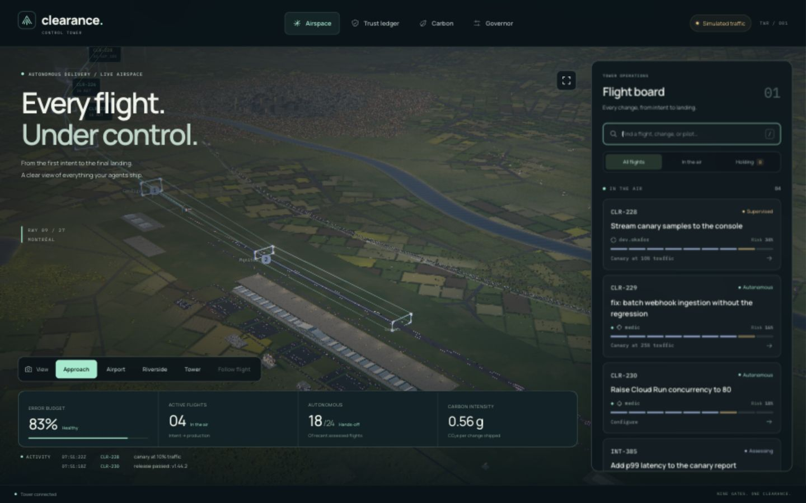
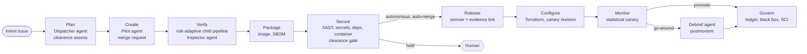

# Clearance

**Every change asks for clearance.** Clearance is a control tower for GitLab Duo agents. It weighs each change's risk against the autonomy its agent has *earned*, then lets the change fly from intent to production on its own, or holds it for a human.



**Current verification:** [the public tower](https://clearance-tower-30123867341.northamerica-northeast1.run.app/tower) is deployed on Cloud Run with labelled simulated traffic. Local checks are reproducible with `node scripts/check-readiness.ts`. Real Duo sessions and public pipeline history are pending account onboarding. See [deployment evidence](proof/cloud-deployment.json), [submission status](hackathon/submission-status.md) and [verification evidence](proof/README.md).

- **Target autonomy:** Hands-off for eligible changes after the pilot earns enough trust. A real end-to-end demonstration is still pending.
- **Lifecycle coverage:** implementation spans all nine stages, from plan through govern; live GitLab evidence is pending.
- **GitLab Duo Agent Platform:** three custom flows, a custom agent, an MCP server for Duo clients, AGENTS.md, an agent skill, and the Duo CLI in CI.
- **Google Cloud:** the visual preview is deployed on Cloud Run in the separate `clearance-tower-20261020` project. Templates also support canaries, Secret Manager and workload identity federation; those live GitLab integrations are not configured yet.

## The problem

Code generation is solved. Shipping is not, and hands-off delivery fails on trust. Teams can't let an agent merge and deploy unless the blast radius is bounded, so they either keep a human on every step or switch autonomy off. Trust is treated as a switch when it should be a track record.

## What Clearance does

1. **A person writes an intent.** The issue gets the `intent` label. Later human involvement depends on the clearance level and the pilot's earned trust.
2. **The Dispatch flow plans and builds it.** A Dispatcher agent writes a flight plan. Before writing any code, it asks the governor what the change would be cleared as, and rescopes until it can fly autonomously. A Pilot agent implements the plan with tests. An independent Inspector agent reviews it, with one rework loop.
3. **The pipeline scores the change.** `clearance assess` combines eight risk signals: sector criticality, size, blast radius, test gap, dependency changes, irreversible changes, critical deletions and security findings. The risk tier then **generates the verification pipeline**. A docs fix gets a link check. A decision-engine rewrite gets the full suite and a soak test.
4. **The governor issues clearance.** This is deterministic code, not a model. It compares the risk with the pilot's earned trust and the service's remaining error budget:

   | Level | Human involvement | Canary steps |
   |---|---|---|
   | Autonomous | None. The MR merges and deploys on its own. | 25% → 50% → 100% |
   | Supervised | One approval of the outcome. | 10% → 25% → 50% → 100% |
   | Assisted | Approval at each step. | 5% → 25% → 50% → 100% |
   | Hold | A code owner must act. | none |

   Some changes are always held: agent edits to the rules that govern agents, critical vulnerabilities and leaked secrets.
5. **The canary is analysed statistically.** The service is deployed to Cloud Run as a zero-traffic revision, then traffic shifts in steps. At each step the canary is tested with a two-proportion z-test on errors, a Mann–Whitney U test on latency and an SLO burn-rate check. If it fails, traffic goes back to the stable revision on its own (a **go-around**), and an incident opens for the Debrief agent's postmortem.
6. **Every flight is governed.** The pilot's trust is updated. A hash-chained, HMAC-signed evidence pack is sealed, mapped to SOC 2, ISO 27001 and NIST SSDF controls. Software Carbon Intensity is reported per change shipped.

### Autonomy is earned

Each pilot, agent or human, has a Beta-distributed track record. The governor uses its **90% lower confidence bound**, so a new Duo agent starts out supervised and needs about **nine clean landings** to fly alone. A landing on a hard approach earns more than an easy one. A go-around on an easy approach costs more than on a hard one. As the service burns its error budget, everyone's autonomy shrinks, and below 10% only fixes may fly.

## The nine stages



| Stage | What runs | GitLab features used |
|---|---|---|
| Plan | Dispatcher agent, `clearance assess`, `clearance predict` | Custom flow, work item trigger, AGENTS.md, agent skill |
| Create | Pilot agent writes code and tests, opens the MR | Custom flow, commits API, merge requests |
| Verify | Child pipeline generated from risk; Inspector agent review | Dynamic child pipelines, JUnit and coverage reports |
| Package | Container image, CycloneDX SBOM | Container registry, CycloneDX report |
| Secure | SAST, secret detection, dependency and container scanning; the gate | Security templates, security policies, CODEOWNERS |
| Release | Semantic version and release notes with evidence link | Releases API, tags |
| Configure | Terraform; image copied to Artifact Registry | GitLab-managed Terraform state, Google Cloud IAM integration |
| Monitor | Progressive traffic, canary statistics, go-around, incident | Environments, resource groups, incidents |
| Govern | Trust ledger, evidence pack, SCI, Debrief agent | Package registry, metrics reports, scheduled audit, Duo CLI |

## GitLab Duo Agent Platform

| Piece | Where | Trigger |
|---|---|---|
| **Dispatch flow**: Dispatcher, Pilot, Inspector and Rework agents with a conditional router | [`.gitlab/duo/flows/clearance-dispatch.yml`](../.gitlab/duo/flows/clearance-dispatch.yml) | Work item created, mention, assign |
| **Medic flow**: diagnoses failed pipelines and pushes minimal fixes, but never bypasses a hold | [`.gitlab/duo/flows/clearance-medic.yml`](../.gitlab/duo/flows/clearance-medic.yml) | Pipeline failed |
| **Debrief flow**: rebuilds the timeline from the black box and writes the postmortem | [`.gitlab/duo/flows/clearance-debrief.yml`](../.gitlab/duo/flows/clearance-debrief.yml) | Mention on an incident |
| **Tower agent**: answers "why was this held?" in Agentic Chat | [`.gitlab/duo/agents/tower.md`](../.gitlab/duo/agents/tower.md) | Chat |
| **MCP server**: `assess_change`, `trust_ledger`, `analyze_canary` and five more tools | [`src/tower/mcp.ts`](../src/tower/mcp.ts), [`.gitlab/duo/mcp.json`](../.gitlab/duo/mcp.json) | Duo in the IDE and the Duo CLI |
| **Agent skill**: flight planning | [`.agents/skills/clearance-flight-planning`](../.agents/skills/clearance-flight-planning/SKILL.md) | Flows, IDE, CLI |
| **Project rules** | [`AGENTS.md`](../AGENTS.md) | Every agent |
| **Flow environment** | [`.gitlab/duo/agent-config.yml`](../.gitlab/duo/agent-config.yml) | Flow runners |

The flows are linted in CI ([`test/flows.test.ts`](../test/flows.test.ts)) against the flow registry v1 rules. The lint checks that every template variable has an input, every router target exists, every conditional router has a default route, every component is reachable, and every system prompt ends with a stopping condition.

## Green software

Clearance reports **SCI = (E × I + M) per R**, with R defined as one change shipped from intent to production. Energy uses the Cloud Carbon Footprint coefficients for Google Cloud. Grid intensity is Google's published 2025 figure per region, and embodied emissions are amortised per vCPU-hour. The savings are structural:

- **Risk-proportional verification.** Jobs a change cannot affect are skipped through test-impact analysis on the import graph, and the skipped work is reported as avoided emissions.
- **Low-carbon placement support.** The visual preview is deployed in `northamerica-northeast1`. The SCI model uses the published regional coefficients documented in the methodology; the preview is not a measured production-savings result.
- **Lean by construction.** The Tower has zero runtime dependencies and ships on a distroless image. The console bundle has a gzip budget enforced in CI, and the 3D renderer is hand-written WebGL2.

See [docs/sci-methodology.md](sci-methodology.md) for the formulas, coefficients, sources and a worked example.

## Run it locally

Node 22.18 or newer runs the TypeScript directly.

```shell
npm ci               # locked browser/build dependencies; the Tower itself needs nothing
npm run dev          # builds the console and starts the Tower on http://localhost:8080
npm test             # engine, CI/flow lint, world geometry, UI build, mock GitLab integration
node test/smoke.ts   # boots the Tower and probes every endpoint
node scripts/check-readiness.ts # all local checks plus labelled local evidence
```

With no GitLab project connected, the Tower flies **simulated traffic through the real decision engine**, and it's labelled as simulated everywhere it appears. To try the governor on your own diff:

```shell
node src/cli/clearance.ts explain
node src/cli/clearance.ts predict --files src/core/governor.ts:120:30
node src/cli/clearance.ts fly --drill --fault errors   # watch a go-around
```

## Set it up on GitLab

[docs/setup.md](setup.md) covers hackathon onboarding, CI/CD variables, the three flows and their triggers, the webhook, and optional deployment. Account approval is an external prerequisite.

## Repository

```
src/core/     decision engine: risk, governor, trust, canary, SLO, SCI, evidence, YAML; no dependencies
src/cli/      `clearance` command used by the pipeline (assess, gate, fly, land, release, evidence, sci, predict)
src/tower/    HTTP server: console, SSE stream, REST, webhooks, MCP, metrics, simulator, GitLab sync
src/web/      console: React-compatible TSX rendered by Preact, plus the WebGL2 airspace renderer
.clearance/   policy.yml and airspace.yml: the rules, protected from agents
.gitlab/      CI includes, Duo flows, agent config, MCP config, templates, CODEOWNERS, security policies
infra/        Terraform for Cloud Run, Artifact Registry, Secret Manager and CI identity
test/         unit tests, flow and CI lint, smoke and soak tests
docs/         setup, architecture, SCI methodology, demo script
```

## License

[MIT](../LICENSE)
